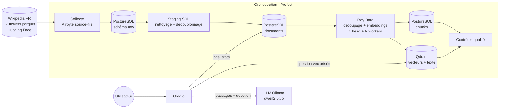

# Pipeline RAG Big Data : recherche sémantique sur Wikipédia FR

**Groupe 6 · Technologies Big Data avancées 2026**

On collecte des articles Wikipédia en français, on les découpe en passages, on les vectorise
en parallèle sur un cluster Ray, puis on les indexe dans une base vectorielle. Une application web
répond ensuite aux questions en citant ses sources : c'est le principe du RAG
(*Retrieval-Augmented Generation*).

Le corpus complet compte environ **2,6 millions d'articles**, répartis en 17 fichiers parquet
(~5 Go compressés). Le pipeline traite ce volume par lots, de façon incrémentale.

## Architecture



| Brique | Technologie | Rôle dans le pipeline | Code |
|---|---|---|---|
| Collecte | **Airbyte** (PyAirbyte, connecteur `source-file`) | Télécharge les fichiers parquet et les écrit dans `raw.wikipedia_fr` | `src/ragpipe/ingestion/` |
| Orchestration | **Prefect 3** | Enchaîne les étapes, gère les reprises sur erreur, la planification et l'historique | `src/ragpipe/orchestration/` |
| Stockage relationnel | **PostgreSQL 16** | Zone brute, documents nettoyés, métadonnées des chunks, suivi des runs et des questions | `sql/init/`, `src/ragpipe/storage/postgres.py`, `staging.py` |
| Stockage NoSQL | **Qdrant** | Base vectorielle : 1 point par passage (vecteur 384 dimensions, texte, titre, URL) | `src/ragpipe/storage/qdrant_store.py` |
| Traitement | **Ray** (Ray Data) | Découpage et embeddings distribués sur un cluster (1 nœud head + N workers) | `src/ragpipe/processing/` |
| Visualisation | **Gradio** | Assistant de questions-réponses, recherche sémantique, tableau de bord du pipeline | `src/ragpipe/app/` |
| Génération | Ollama (`qwen2.5:7b`) | Rédige la réponse à partir des passages retrouvés | `src/ragpipe/retrieval/` |

### Déroulé d'un run

1. **Collecte** : Airbyte lit un ou plusieurs fichiers parquet en HTTPS et les ajoute à la table `raw.wikipedia_fr`.
2. **Staging** : une requête SQL dédoublonne les articles, écarte ceux de moins de 500 caractères et
   alimente `documents`. Un article modifié repasse en « à vectoriser » grâce à son empreinte md5.
   La zone brute est ensuite vidée.
3. **Vectorisation** : Prefect soumet un job au cluster Ray. Ray lit les documents par plages,
   les découpe en passages d'environ 500 caractères (75 de chevauchement, car le modèle ne lit que 128 tokens) et calcule les
   embeddings avec un pool d'acteurs, chacun chargeant le modèle une seule fois. Il écrit ensuite
   les vecteurs dans Qdrant et les métadonnées dans PostgreSQL.
4. **Contrôles** : on vérifie que PostgreSQL et Qdrant contiennent le même nombre de passages.
   Le run est enregistré dans `pipeline_runs`.

Les identifiants des passages sont déterministes (UUID v5 de `doc_id:index`). On peut donc relancer
un run sans créer de doublons.

## Répartition des rôles (proposition)

Elle reprend l'ordre du tableau d'inscription. Chacun est responsable d'une brique : il la fait
évoluer, la présente à la soutenance et documente ses choix.

| Membre | Responsabilité | Fichiers | Premières tâches |
|---|---|---|---|
| Salma Abarkane | Cheffe de projet, architecture, intégration | `docker-compose.yml`, `README.md`, rapport | Planning, revue des PR, schéma d'architecture, slides |
| Rania Bouaroua | Collecte (Airbyte) | `ingestion/` | Ajouter une 2ᵉ source (ex. HAL ou arXiv), comparer PyAirbyte et la plateforme Airbyte (`abctl`) |
| Salma Benmouma | Orchestration (Prefect) | `orchestration/` | Planification, notifications d'échec, run qui parcourt les 17 fichiers |
| Oumaima Gassi | Stockage relationnel (PostgreSQL) | `sql/`, `storage/postgres.py`, `storage/staging.py` | Vues analytiques, partitionnement de `documents`, nettoyage du texte en SQL |
| Imad Eddine El Khorassani | Stockage NoSQL (Qdrant) | `storage/qdrant_store.py` | Réglages HNSW, quantification, filtres, mesure mémoire et latence |
| Mohammed Yassine Benmeziane | Traitement distribué (Ray) | `processing/` | Benchmark de 1 à N workers, réglage des acteurs et des lots, tolérance aux pannes |
| Anys Louzal | Visualisation et partage (Gradio) | `app/` | Graphiques de suivi, filtres, partage public (`share=True` ou Hugging Face Spaces) |
| Mohamed Anouar Faress | Couche RAG et évaluation | `retrieval/` | Prompt, re-ranking, jeu de questions de test, métriques de qualité |

## Démarrage

### Prérequis

- **Docker Desktop**, avec au moins **8 Go de RAM** alloués (Réglages → Resources) pour la configuration
  par défaut (1 worker Ray). Comptez environ 1,5 Go de plus par worker supplémentaire, et pensez aux
  autres conteneurs qui tournent déjà dans Docker (`docker stats`).
- **Ollama** installé sur la machine (<https://ollama.com>), avec le modèle de génération téléchargé :

```bash
ollama pull qwen2.5:7b
```

Sur une machine modeste, choisissez un modèle plus léger (`qwen2.5:3b`) et changez `LLM_MODEL` dans `.env`.
Sous Linux, lancez Ollama avec `OLLAMA_HOST=0.0.0.0` pour que les conteneurs puissent le joindre.

### Lancer le projet

```bash
cp .env.example .env
```

```bash
docker compose up -d --build
```

La première construction prend environ 10 minutes. Elle installe les dépendances, le connecteur
Airbyte et le modèle d'embedding.

```bash
make run
```

`make run` collecte le fichier 16 (~186 Mo), puis vectorise 2 000 articles. Ensuite, ouvrez
l'application et posez une question.

| Interface | URL |
|---|---|
| Application Gradio | <http://localhost:7860> |
| Prefect (runs, planification) | <http://localhost:4200> |
| Dashboard Ray (cluster, jobs) | <http://localhost:8265> |
| Dashboard Qdrant | <http://localhost:6333/dashboard> |
| PostgreSQL | `localhost:5432`, utilisateur `rag`, mot de passe `rag` |

### Autres façons de lancer un run

- **Depuis l'interface Prefect** : Deployments → `pipeline-rag/wikipedia-fr` → Run. Vous pouvez y
  modifier les paramètres (`shards`, `max_docs`…) et activer la planification nocturne.
- **En ligne de commande**, avec tous les paramètres :

```bash
docker compose exec pipeline python -m ragpipe.orchestration.flows --shards 14 15 --max-docs 20000
```

- **Vectoriser seulement** les documents déjà collectés :

```bash
make run-quick
```

### Commandes utiles

| Commande | Effet |
|---|---|
| `make test` | Tests unitaires |
| `make logs` | Logs de tous les services |
| `make down` | Arrête les services (les données sont conservées) |
| `make reset` | Arrête tout **et efface** PostgreSQL et Qdrant |
| `docker compose up -d --scale ray-worker=2` | Change le nombre de workers Ray à chaud (penser à `--embed-actors 2`) |

## Passage à l'échelle

| Paramètre | Où | Effet |
|---|---|---|
| `shards` | Prefect / CLI | Nombre de fichiers collectés (17 au total, ~150 000 articles chacun) |
| `max_docs` | Prefect / CLI | Documents vectorisés par run. Les runs suivants reprennent où le précédent s'est arrêté |
| `RAY_WORKERS` | `.env` | Nombre de workers Ray (3 CPU et ~1,5 Go chacun : 1 acteur d'embedding + lecture/écriture) |
| `EMBED_ACTORS` | `.env`, Prefect, CLI (`--embed-actors`) | Acteurs d'embedding en parallèle : 1 par worker |

### Premières mesures

Mesures prises sur un MacBook (10 cœurs, 8 Go alloués à Docker), avec le fichier 16 :

| Étape | Volume | Durée |
|---|---|---|
| Collecte Airbyte + staging | 150 861 articles lus, 112 313 retenus (≥ 500 caractères) | ~2 min |
| Vectorisation Ray, 1 worker | 1 700 articles → 12 102 passages | 426 s (~28 passages/s) |

Un article donne en moyenne 7 passages. À ce rythme, le fichier 16 complet (~800 000 passages)
demanderait environ 8 heures avec 1 worker, et le corpus entier plus d'une semaine : c'est tout
l'intérêt de distribuer le calcul. Mesure à faire pour le rapport : le débit avec 1, 2 puis 4 workers
(`RAY_WORKERS` et `EMBED_ACTORS` dans `.env`), sur une machine qui a assez de RAM.

## Structure du dépôt

```
├── docker-compose.yml        services : postgres, qdrant, prefect-server, ray-head, ray-worker (×N), pipeline, app
├── Dockerfile                image Python unique pour tous les services du projet
├── requirements.txt          dépendances directes
├── requirements.lock         versions figées : toute l'équipe a exactement les mêmes
├── sql/init/                 schéma PostgreSQL (créé au premier démarrage)
├── src/ragpipe/
│   ├── config.py             paramètres lus depuis .env
│   ├── ingestion/            collecte Airbyte
│   ├── storage/              PostgreSQL, staging SQL, Qdrant
│   ├── processing/           découpage, embeddings, job Ray
│   ├── retrieval/            recherche sémantique + appel au LLM
│   ├── orchestration/        flow et déploiement Prefect
│   └── app/                  application Gradio
└── tests/                    tests unitaires (pytest)
```

Le dossier `src/` est monté dans les conteneurs. Une modification du code est prise en compte au
redémarrage du service, par exemple `docker compose restart app`, sans reconstruire l'image.

## Travail en équipe

- Une branche par brique (`collecte`, `prefect`, `postgres`, `qdrant`, `ray`, `gradio`, `rag`) et
  une pull request vers `main`, relue par un autre membre.
- Ne jamais commiter `.env`. Tout nouveau paramètre va dans `.env.example` et `config.py`.
- Pour ajouter une dépendance, mettez-la dans `requirements.txt`, puis régénérez `requirements.lock`.

## Problèmes fréquents

| Symptôme | Solution |
|---|---|
| « LLM injoignable » dans l'application | Vérifier qu'Ollama tourne (`ollama list`) et que le modèle de `.env` est téléchargé |
| Job Ray très lent ou en échec, « worker died » / « killed due to memory pressure » | Manque de RAM. Vérifier `docker exec ragpipe-ray-worker-1 cat /sys/fs/cgroup/memory.events` : `oom_kill` > 0 avec `max 0` signifie que c'est toute la VM Docker qui est pleine. Réduire `RAY_WORKERS`, arrêter les autres conteneurs ou augmenter la mémoire de Docker |
| Port déjà utilisé | Changer le port de gauche dans `docker-compose.yml` (ex. `"5433:5432"`) |
| Repartir de zéro | `make reset`, puis `docker compose up -d` |
